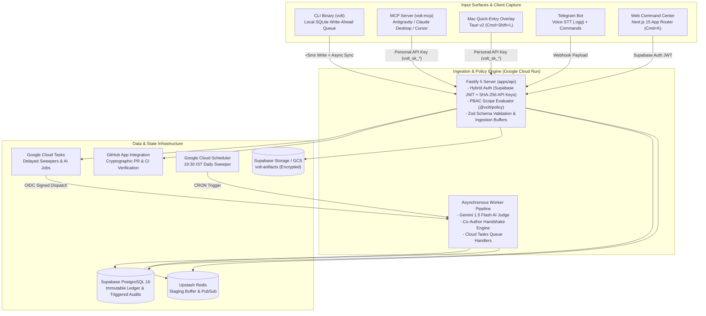

<div align="center">

# `volt`

### **The Zero-Friction Impact & Mathematical Weightage Engine**

*Replace time sheets with cognitive complexity, business leverage, and verifiable empirical proof.*

[](LICENSE)
[](https://bun.sh)
[-black.svg?logo=next.js)](https://nextjs.org)
[](https://fastify.dev)
[-336791.svg?logo=postgresql)](https://supabase.com)
[](https://orm.drizzle.team)
[](https://upstash.com)
[](https://deepmind.google/technologies/gemini/)

[Key Features](#key-features) • [Math Engine](#mathematical-weightage-engine-wc) • [System Architecture](#system-architecture) • [Commercial Licensing](#commercial-licensing--enterprise-support) • [Quick Start](#quick-start) • [CLI & MCP](#cli-mcp--developer-tooling) • [Documentation](#documentation-suite)

</div>

---

## Overview

**`volt`** is an output-based compensation, contribution tracking, and mathematical weightage platform disguised as a zero-friction developer tool. It replaces legacy hourly timesheets with a Git-inspired staging and commit workflow:

$$\text{Micro-tasks} \xrightarrow{\texttt{volt add}} \text{Staging Buffer} \xrightarrow{\texttt{volt commit}} \text{Verified Proof \& AI Evaluation}$$

Designed for high-agency teams across **Engineering**, **Empirical Research**, **Operations**, **Finance**, and **Growth**, `volt` directly decouples compensation from hours logged. Instead, it computes impact through non-linear cognitive complexity, verifiable business leverage, cryptographic proof, and peer consensus.

---

## Key Invariants

| Invariant | Principle | Implementation Mechanism |
| :--- | :--- | :--- |
| **3-Second Capture Rule** | Logging must take $<3\text{s}$ human thought and $<50\text{ms}$ terminal response time. | Embedded SQLite write-ahead queue (`~/.volt/queue.sqlite` via `bun:sqlite`) syncing asynchronously to cloud ingestion. |
| **Complexity Over Hours** | Hours spent are never rewarded. A 2-hour breakthrough exponentially outweighs 8 hours of routine maintenance. | Exponential power law ($C^{1.4}$) on Modified Fibonacci complexity ($C \in \{1, 2, 3, 5, 8, 13\}$). |
| **Epistemic Parity** | Rigorous R&D that disproves a hypothesis with empirical benchmarks is rewarded equally to production code. | Domain rubrics grade hypothesis, methodology, and empirical refutation on equal footing with shipping features. |
| **Immutable Ledger** | Every score derivation, AI evaluation, co-author handshake, and audit trail is immutable. | Append-only PostgreSQL 16 `score_audits` ledger guarded by database triggers preventing `UPDATE` and `DELETE`. |
| **Strict Modularity** | Clean architecture, total type safety, and zero code bloat. | 200-line file limit, centralized type registries (`@volt/types`), zero `any`/`unknown`, centralized route constants (`AppRoutes`, `ApiRoutes`). |

---

## Mathematical Weightage Engine ($W_c$)

Every committed unit of work undergoes automated evaluation to derive its **Base Commit Weight Score ($W_c$)**:

$$W_{\text{initial}} = C^{1.4} \times I \times E$$

$$W_c = \text{round}\left( W_{\text{initial}} \times V \times D, \, 2 \right)$$

### Parameter Specifications

1. **Cognitive Complexity ($C \in \{1, 2, 3, 5, 8, 13\}$)**
   * Non-linear exponentiation ($C^{1.4}$) ensures high-order problem solving receives compounding rewards:
     * $C=1$ ($1.00\times$): Trivial hygiene, typos, administrative updates.
     * $C=2$ ($2.64\times$): Routine patches, standard copy, basic scripts.
     * $C=3$ ($4.66\times$): Standard execution, CRUD flows, unit test suites.
     * $C=5$ ($9.52\times$): Multi-system integrations, baseline ML fine-tuning, strategic pitch narratives.
     * $C=8$ ($18.38\times$): Complex distributed architecture, novel deep research, multi-scenario financial models.
     * $C=13$ ($36.26\times$): Breakthrough engineering, foundational algorithms, mission-critical pivot benchmarks.

2. **Business Impact Multiplier ($I \in \{0.5, 1.0, 1.5, 2.0, 3.0\}$)**
   * Evaluates organizational leverage, unblocking critical path dependencies, user acquisition, and direct operational efficiency.

3. **Evidence & Artifact Multiplier ($E \in \{0.5, 1.0, 1.2\}$)**
   * $0.5\times$: Unverified claims without supporting artifacts.
   * $1.0\times$: Verified GitHub PRs/commits (via installed GitHub App) or attached deliverables (`.ipynb`, PDF, video, metrics).
   * $1.2\times$: Exceptional end-to-end documentation, automated tests, and reproducible benchmarks.

4. **Verification Consensus Modifier ($V \in [0.70, 1.30]$)**
   * Peer review calibration and algorithmic confidence modifiers.

5. **Timeliness Decay Factor ($D \in [0.50, 1.00]$)**
   * Rewards real-time, zero-friction logging over delayed batch entries.

### Group Split & Pool Share Dynamics

* **Co-Author Split ($N$ Contributors):**
  * $N \in [1, 3]$: Full credit duplication (encourages high-velocity collaboration).
  * $N \ge 4$: Split formula $\text{Share} = \frac{3}{N} \times W_c$ (guards against credit dilution and free-riding).
* **Bonus Pool Distribution:**
  $$\text{Payout}_u = \text{BonusPool} \times \left( \frac{\sum W_{c, u}}{\sum_{\text{all}} W_{c}} \right)$$

---

## System Architecture



---

## Monorepo Topology

`volt` is structured as a strict, modular Bun and Turborepo monorepo adhering to separation of concerns and the 200-line file limit:

```text
volt/
├── apps/
│   ├── api/             # Fastify 5 REST API, PBAC guard, task workers (Cloud Run)
│   ├── web/             # Next.js 15 (React 19) Command Center & Linear-dark UI
│   ├── cli/             # 'volt' binary with local SQLite write-ahead queue
│   ├── mcp/             # 'volt-mcp' Model Context Protocol daemon for AI IDEs
│   ├── mac-overlay/     # Tauri v2 native Mac quick-entry overlay (Cmd+Shift+L)
│   └── bot/             # Telegram bot handler with voice STT transcribing
├── packages/
│   ├── types/           # Centralized TypeScript models, routes, DTOs (@volt/types)
│   ├── db/              # Drizzle ORM schema, migrations, connection pool (@volt/db)
│   ├── policy/          # Policy-Based Access Control engine (@volt/policy)
│   ├── math/            # Pure, zero-dependency weightage calculator (@volt/math)
│   └── ui/              # Tailwind CSS / Lucide-react design system components
├── docs/                # Comprehensive 11-part architectural specifications
└── LICENSE              # MIT License
```

---

## Quick Start

### Prerequisites

* [Bun](https://bun.sh) (v1.2.0 or later)
* Node.js (v20+ LTS)
* PostgreSQL 16 (or Supabase instance)
* Upstash Redis (or local Redis instance)
* Google Cloud CLI (`gcloud`) & Gemini API Key

### Installation

```bash
# Clone the repository
git clone https://github.com/hi-ashwinsharma/volt.git
cd volt

# Install dependencies across all workspaces
bun install

# Configure environment variables
cp .env.example .env
```

### Database Setup & Migrations

```bash
# Generate and run Drizzle migrations
bun run db:generate
bun run db:migrate

# Seed policy groups and initial admin cycle
bun run db:seed
```

### Running Locally

```bash
# Run API, Web, and Worker services in development mode
bun run dev

# Run only the Fastify API
bun --filter @volt/api dev

# Run only the Next.js Web Command Center
bun --filter @volt/web dev
```

---

## CLI, MCP & Developer Tooling

### 1. `volt` CLI

The CLI is engineered with a **`<5ms` local SQLite write-ahead queue**, ensuring developers are never blocked by cold starts or offline states.

```bash
# Authenticate CLI with your workspace
volt login

# Add micro-tasks to the local staging buffer (<50ms)
volt add "Migrated auth middleware to Fastify 5"
volt add "Added Redis caching layer for active cycles"

# Inspect current staged tasks
volt status

# Commit staged tasks with domain, complexity, and artifacts
volt commit -m "Complete auth and cache migration" \
  --domain engineering \
  --complexity 5 \
  --pr 142 \
  --co @alex

# View personal score breakdown and active cycle pool share
volt pool
```

### 2. Model Context Protocol (`volt-mcp`)

Connect `volt` directly into agentic coding environments (Antigravity, Claude Desktop, Cursor):

```json
{
  "mcpServers": {
    "volt": {
      "command": "volt-mcp",
      "env": {
        "VOLT_API_KEY": "volt_sk_live_...",
        "VOLT_API_URL": "https://api.volt.build"
      }
    }
  }
}
```

Available MCP Tools:
* `volt_stage_task`: Automatically stage completed tasks during an agent coding session.
* `volt_commit_work`: Synthesize work, attach git diffs, and submit for evaluation.
* `volt_get_pool_status`: Query active cycle impact metrics and pool share standings.

---

## Documentation Suite

The complete engineering specification is documented in [`docs/`](docs/):

* [00 — Documentation Index & Architecture Decisions](docs/00-index.md)
* [01 — System Vision & Mathematical Weightage Engine](docs/01-vision-and-math-engine.md)
* [02 — System Architecture & Monorepo Topology](docs/02-system-architecture.md)
* [03 — Database Schema, ERD & Drizzle ORM Specification](docs/03-database-schema.md)
* [04 — Policy-Based Access Control (PBAC) & Security Model](docs/04-pbac-and-security.md)
* [05 — Commit Lifecycle, Co-Author Handshake & AI Judge Pipeline](docs/05-pipeline-and-state-machines.md)
* [06 — GitHub App Integration & Artifact Verification Pipeline](docs/06-github-app-and-artifacts.md)
* [07 — REST API, CLI (`volt`) & MCP (`volt-mcp`) Contracts](docs/07-api-cli-mcp-contracts.md)
* [08 — Web Command Center & Mac Overlay Design System](docs/08-ui-ux-design-system.md)
* [09 — Cloud-Native Infrastructure, Provisioning & Runbook](docs/09-infrastructure-and-runbook.md)
* [10 — Phased Engineering Roadmap & Verification Matrix](docs/10-engineering-roadmap.md)

---

## Security & Verification

* **Dual-Authentication Protocol:** Browser sessions utilize Supabase Auth JWTs with PKCE. Headless clients (CLI, MCP, Mac Overlay) use high-entropy `volt_sk_...` tokens stored via salted SHA-256 hashes.
* **PBAC Authorization:** Reusable Policy Groups and granular scopes (`commit:create`, `commit:review_peer`, `cycle:manage`) decouple access from job titles. Conflict-of-interest guards strictly prevent self-review.
* **Artifact Cryptography:** Verification relies exclusively on installed GitHub App OAuth tokens and pre-signed multipart uploads, preventing spoofed URLs.

---

---

## Commercial Licensing & Enterprise Support

`volt` is open source under the **GNU Affero General Public License v3 (AGPLv3)**.

### For Open Source & Community Users
You are free to use, run, study, and modify `volt` under the terms of the AGPLv3. If you run a modified version of `volt` over a network (e.g., hosting it for your users or internal team), you are required under the AGPLv3 to make your modified source code publicly accessible under the same license.

### For Companies & Commercial Organizations
If your organization wishes to deploy `volt` internally or integrate it into proprietary infrastructure **without** being bound by the copyleft obligations of the AGPLv3 (e.g. keeping your internal compensation data, custom organizational rubrics, or proprietary extensions closed-source), you can purchase a **Commercial Enterprise License**.

Our Commercial Offerings include:
* **Self-Hosted Enterprise License:** Closed-source exemption for private deployments, custom internal branding, and proprietary PBAC integrations.
* **Fully Managed Cloud (SaaS):** Zero-ops hosted infrastructure with managed Supabase DB, Google Cloud Run ingestion, automated Gemini 1.5 Flash AI grading, and Telegram bots.
* **Dedicated Support & Custom Integrations:** Priority SLAs, custom HR/payroll connectors, and tailored impact rubric calibration.

To discuss commercial licensing terms or request an enterprise demo:
* **Email:** [hi.ashwinsharma@gmail.com](mailto:hi.ashwinsharma@gmail.com)
* **Website:** [https://hi-ashwin.xyz](https://hi-ashwin.xyz)

---

## Contributing

We welcome community contributions adhering to our architectural invariants:

1. Create a feature branch from `main`:
   ```bash
   git checkout -b feat/my-feature
   ```
2. Adhere to the **200-line file limit**, centralized types in `@volt/types`, and zero `any`/`unknown`.
3. Run linting and test suites:
   ```bash
   bun run lint
   bun run test
   ```
4. Submit a Pull Request with linked issues and verifiable artifacts.

> *Note: Contributors assign copyright or grant broad usage rights to the project maintainers to allow ongoing dual licensing.*

---

## License

Dual-licensed under the **GNU Affero General Public License v3.0 (AGPLv3)** and a **Commercial Enterprise License**. See [`LICENSE`](LICENSE) for complete details.

