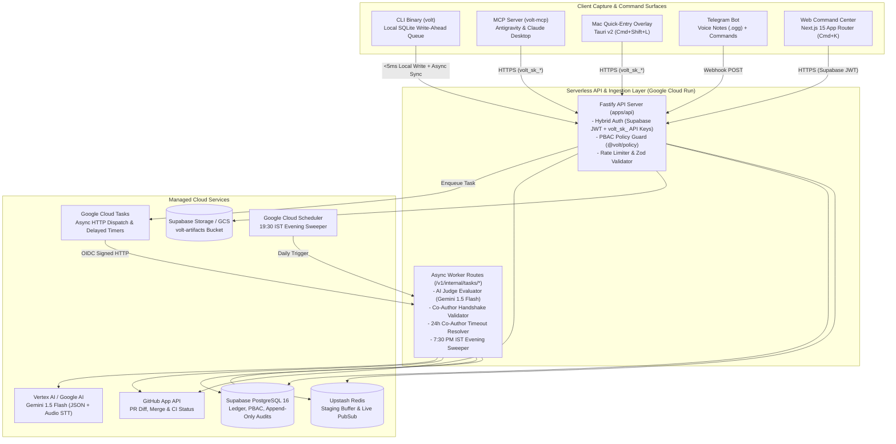
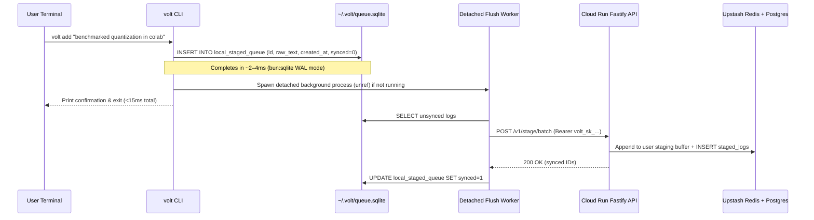

# 02 — System Architecture & Monorepo Topology

**Document ID:** `VOLT-DOC-02`  
**Parent Index:** [00-index.md](file:///Users/ashwinsharma/coldcrunch/volt/docs/00-index.md)

---

## 1. High-Level System Architecture

`volt` is architected as a cloud-native, scale-to-zero serverless platform paired with ultra-fast local capture clients.



---

## 2. The `<50ms` Local Write-Ahead Capture Architecture

Google Cloud Run scales to zero when idle, meaning a cold start can take `300ms–800ms`. To strictly satisfy **Core Invariant #1** (`volt add` must complete in `<50ms`), the CLI and Mac Overlay implement a **Two-Tier Write-Ahead Staging Architecture**:



* **Immediate Local Availability:** Running `volt status` reads both the synced server state and any unsynced rows in `~/.volt/queue.sqlite`, providing instant consistency even offline.
* **Pre-Commit Flush:** Running `volt commit` synchronously flushes any remaining unsynced rows in `~/.volt/queue.sqlite` before creating the commit.

---

## 3. Monorepo Directory Structure (Turborepo + Bun)

To enforce our **Clean Architecture & 200-Line File Limit** and **Centralized Types** rules, the repository is organized into strict workspaces:

```text
volt/
├── docs/                           # Complete engineering documentation suite (00..10)
├── package.json                    # Bun workspace root + Turborepo scripts
├── turbo.json                      # Pipeline caching & build orchestration
├── tsconfig.base.json              # Strict TypeScript config (strict: true, noImplicitAny)
├── .env.example                    # Documented cloud-native environment template
│
├── packages/
│   ├── types/                      # @volt/types — SINGLE SOURCE OF TRUTH for all types/DTOs
│   │   └── src/
│   │       ├── index.ts
│   │       ├── domain.types.ts     # CommitType, WorkDomain, CommitStatus, CaptureSource
│   │       ├── math.types.ts       # ComplexityScore, ImpactMultiplier, WeightageBreakdown
│   │       ├── pbac.types.ts       # PermissionScope, PolicyGroup, UserPolicyContext
│   │       ├── commit.types.ts     # CommitRecord, CoAuthorRecord, ScoreAuditRecord
│   │       ├── github.types.ts     # GitHubAppInstallation, PrVerificationMetadata
│   │       ├── api.types.ts        # Request/Response DTOs for all endpoints
│   │       └── routes.constants.ts # Centralized ApiRoutes & AppRoutes registries
│   │
│   ├── config/                     # @volt/config — Zod schemas & runtime validation
│   │   └── src/
│   │       ├── env.schema.ts       # Cloud-native env validator
│   │       └── api.schemas.ts      # Request/Response & Gemini JSON schemas
│   │
│   ├── math/                       # @volt/math — Pure deterministic weightage engine
│   │   └── src/
│   │       ├── weightage.ts        # W_c = (C^1.4 * I * E) * V * D calculator
│   │       ├── decay.ts            # IST timeliness decay calculator
│   │       ├── allocation.ts       # 1-3 author 100% duplication vs 4+ split (3/N)
│   │       └── pool-share.ts       # Dynamic bonus pool share % & payout math
│   │
│   ├── policy/                     # @volt/policy — Flat PBAC permission evaluation engine
│   │   └── src/
│   │       ├── scopes.constants.ts # Canonical permission scopes & default policy groups
│   │       ├── evaluator.ts        # hasScope(), assertScope(), canReviewCommit()
│   │       └── guards.ts           # Conflict-of-interest & self-review prevention
│   │
│   └── db/                         # @volt/db — Drizzle ORM schema, migrations & repositories
│       ├── drizzle.config.ts
│       ├── migrations/             # SQL migrations + append-only audit triggers
│       └── src/
│           ├── client.ts           # Supabase Postgres connection pool
│           ├── schema/             # Modular table definitions (<200 lines each)
│           └── repositories/       # Typed data access layer
│
└── apps/
    ├── api/                        # @volt/api — Fastify serverless backend (Cloud Run)
    │   ├── Dockerfile
    │   └── src/
    │       ├── server.ts
    │       ├── plugins/            # Auth (Supabase JWT + volt_sk_), PBAC, RateLimit, CORS
    │       ├── routes/             # Modular route handlers using ApiRoutes constants
    │       ├── services/           # GitHub App verifier, Storage signer, Cloud Tasks, Gemini Judge
    │       └── workers/            # Cloud Tasks & Cloud Scheduler webhook handlers
    │
    ├── cli/                        # @volt/cli — Standalone compiled CLI (`volt`) + admin CLI
    │   └── src/
    │       ├── index.ts
    │       ├── local-store/        # ~/.volt/queue.sqlite & ~/.volt/config.json
    │       ├── daemon/             # Background flush worker
    │       └── commands/           # add, status, commit, verify, login, infra-setup
    │
    ├── mcp/                        # @volt/mcp — Model Context Protocol Server (`volt-mcp`)
    │   └── src/
    │       ├── index.ts
    │       └── tools/              # volt_stage_log, volt_commit_work, volt_get_status
    │
    ├── web/                        # @volt/web — Next.js 15 Apple-Esque Web Command Center
    │   └── src/
    │       ├── app/                # App Router pages using AppRoutes
    │       ├── components/         # Glassmorphic UI primitives (<200 lines each, zero types inside)
    │       ├── hooks/              # Custom hooks (business logic & state decoupled from UI)
    │       └── services/           # Typed API client & Supabase Auth client
    │
    └── mac-overlay/                # @volt/mac-overlay — Tauri v2 floating quick-entry bar
        ├── src-tauri/              # Rust native global shortcut (Cmd+Shift+L) & window manager
        └── src/                    # Lightweight React/Tailwind Spotlight bar
```

---

## 4. Architectural Guardrails & Dependency Rules

1. **Unidirectional Package Dependency Graph:**
   * `@volt/types` has **zero** internal dependencies.
   * `@volt/math`, `@volt/policy`, and `@volt/config` depend only on `@volt/types` (and `zod`).
   * `@volt/db` depends on `@volt/types` and `@volt/config`.
   * Applications (`apps/api`, `apps/cli`, `apps/mcp`, `apps/web`, `apps/mac-overlay`) consume workspace packages (`@volt/*`) and never import across `apps/*`.
2. **Centralized Route Registries (`packages/types/src/routes.constants.ts`):**
   * `ApiRoutes` defines every backend path (e.g., `ApiRoutes.stage.create`, `ApiRoutes.commits.verify`).
   * `AppRoutes` defines every frontend route (e.g., `AppRoutes.stream`, `AppRoutes.peerReviews`, `AppRoutes.poolMatrix`, `AppRoutes.settingsGitHub`).
   * Neither string literals nor ad-hoc path interpolations are permitted outside the route helper functions.
