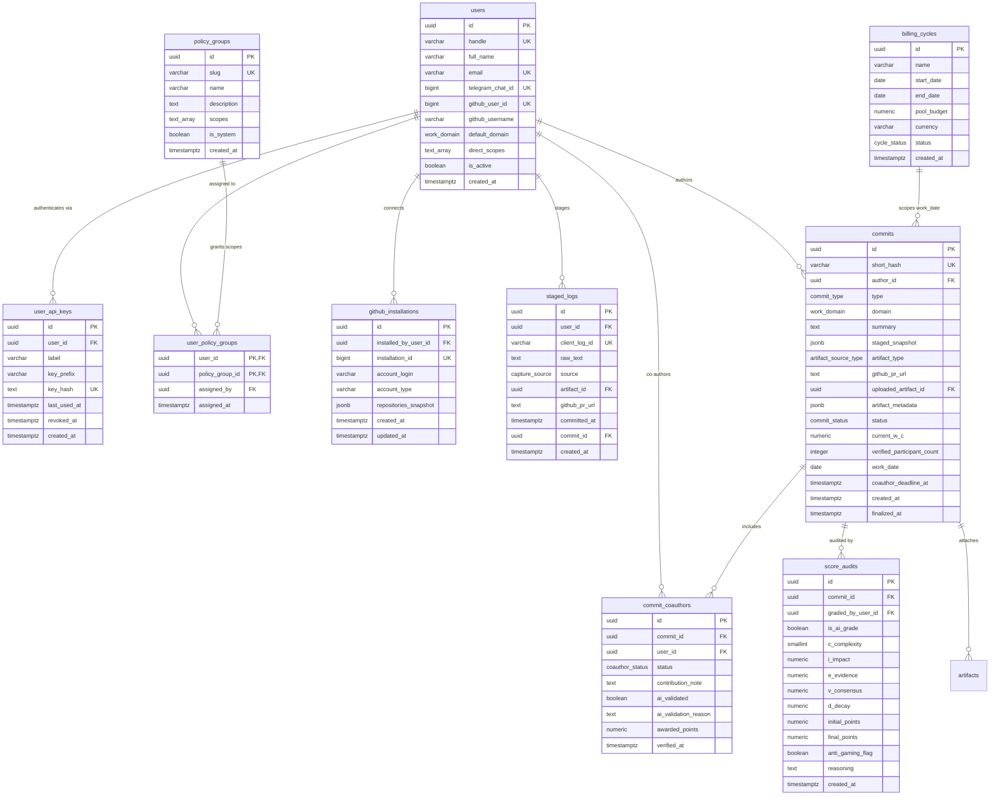

# 03 — Database Schema, ERD & Drizzle ORM Specification

**Document ID:** `VOLT-DOC-03`  
**Parent Index:** [00-index.md](file:///Users/ashwinsharma/coldcrunch/volt/docs/00-index.md)

---

## 1. Entity-Relationship Diagram (ERD)

The PostgreSQL 16 schema on Supabase is designed around four pillars:
1. **Identity, API Keys & PBAC Policies** (`users`, `user_api_keys`, `policy_groups`, `user_policy_groups`)
2. **GitHub App & Artifact Storage** (`github_installations`, `artifacts`)
3. **Staging & Commit Ledger** (`staged_logs`, `commits`, `commit_coauthors`)
4. **Immutable Audit & Compensation Cycles** (`score_audits`, `billing_cycles`)



---

## 2. Complete PostgreSQL 16 DDL Specification

```sql
-- ============================================================================
-- 1. ENUMERATED TYPES
-- ============================================================================
CREATE TYPE commit_type AS ENUM ('output', 'insight');

CREATE TYPE work_domain AS ENUM (
    'engineering',
    'research',
    'ops',
    'finance',
    'pitch'
);

CREATE TYPE commit_status AS ENUM (
    'pending_coauthor', -- Waiting for tagged co-authors to verify (or 24h timeout)
    'pending_ai',       -- Ready for / currently undergoing Gemini 1.5 Flash evaluation
    'pending_peer',     -- Initial score > 15.0 pts or flagged; awaiting peer reviewer
    'approved',         -- Finalized and counted toward Dynamic Pool Share
    'rejected'          -- Rejected by peer reviewer for gaming / invalid claim
);

CREATE TYPE coauthor_status AS ENUM (
    'pending',
    'verified',
    'rejected',
    'timed_out'
);

CREATE TYPE capture_source AS ENUM (
    'cli',
    'mcp',
    'mac_overlay',
    'telegram',
    'web'
);

CREATE TYPE artifact_source_type AS ENUM (
    'none',
    'github_app',
    'file_upload'
);

CREATE TYPE cycle_status AS ENUM (
    'upcoming',
    'active',
    'closed'
);

-- ============================================================================
-- 2. USERS, API KEYS & PBAC POLICY TABLES
-- ============================================================================
CREATE TABLE users (
    id UUID PRIMARY KEY DEFAULT gen_random_uuid(),
    supabase_auth_id UUID UNIQUE,
    handle VARCHAR(50) UNIQUE NOT NULL,
    full_name VARCHAR(100) NOT NULL,
    email VARCHAR(255) UNIQUE NOT NULL,
    avatar_url TEXT,
    telegram_chat_id BIGINT UNIQUE,
    github_user_id BIGINT UNIQUE,
    github_username VARCHAR(100),
    default_domain work_domain NOT NULL DEFAULT 'engineering',
    direct_scopes TEXT[] NOT NULL DEFAULT '{}',
    is_active BOOLEAN NOT NULL DEFAULT TRUE,
    created_at TIMESTAMPTZ NOT NULL DEFAULT NOW(),
    updated_at TIMESTAMPTZ NOT NULL DEFAULT NOW()
);

CREATE TABLE policy_groups (
    id UUID PRIMARY KEY DEFAULT gen_random_uuid(),
    slug VARCHAR(64) UNIQUE NOT NULL, -- e.g. 'member-default', 'peer-reviewer', 'pool-manager', 'policy-admin'
    name VARCHAR(100) NOT NULL,
    description TEXT NOT NULL,
    scopes TEXT[] NOT NULL DEFAULT '{}',
    is_system BOOLEAN NOT NULL DEFAULT FALSE,
    created_at TIMESTAMPTZ NOT NULL DEFAULT NOW()
);

CREATE TABLE user_policy_groups (
    user_id UUID NOT NULL REFERENCES users(id) ON DELETE CASCADE,
    policy_group_id UUID NOT NULL REFERENCES policy_groups(id) ON DELETE CASCADE,
    assigned_by UUID REFERENCES users(id) ON DELETE SET NULL,
    assigned_at TIMESTAMPTZ NOT NULL DEFAULT NOW(),
    PRIMARY KEY (user_id, policy_group_id)
);

CREATE TABLE user_api_keys (
    id UUID PRIMARY KEY DEFAULT gen_random_uuid(),
    user_id UUID NOT NULL REFERENCES users(id) ON DELETE CASCADE,
    label VARCHAR(100) NOT NULL, -- e.g. 'MacBook Pro CLI', 'Antigravity MCP'
    key_prefix VARCHAR(16) NOT NULL, -- e.g. 'volt_sk_9f8a...'
    key_hash TEXT UNIQUE NOT NULL, -- SHA-256 hex digest of full key
    last_used_at TIMESTAMPTZ,
    revoked_at TIMESTAMPTZ,
    created_at TIMESTAMPTZ NOT NULL DEFAULT NOW()
);

-- ============================================================================
-- 3. GITHUB APP INSTALLATIONS & UPLOADED ARTIFACTS
-- ============================================================================
CREATE TABLE github_installations (
    id UUID PRIMARY KEY DEFAULT gen_random_uuid(),
    installed_by_user_id UUID NOT NULL REFERENCES users(id) ON DELETE CASCADE,
    installation_id BIGINT UNIQUE NOT NULL,
    account_login VARCHAR(100) NOT NULL,
    account_type VARCHAR(32) NOT NULL, -- 'User' | 'Organization'
    repositories_snapshot JSONB NOT NULL DEFAULT '[]'::jsonb,
    suspended_at TIMESTAMPTZ,
    created_at TIMESTAMPTZ NOT NULL DEFAULT NOW(),
    updated_at TIMESTAMPTZ NOT NULL DEFAULT NOW()
);

CREATE TABLE artifacts (
    id UUID PRIMARY KEY DEFAULT gen_random_uuid(),
    uploader_id UUID NOT NULL REFERENCES users(id) ON DELETE CASCADE,
    storage_bucket VARCHAR(100) NOT NULL DEFAULT 'volt-artifacts',
    storage_path TEXT UNIQUE NOT NULL,
    original_filename VARCHAR(255) NOT NULL,
    mime_type VARCHAR(120) NOT NULL,
    size_bytes BIGINT NOT NULL CHECK (size_bytes > 0),
    sha256_checksum VARCHAR(64) NOT NULL,
    extracted_metadata JSONB NOT NULL DEFAULT '{}'::jsonb, -- Colab cell/metric summary, PDF page count, image dimensions
    created_at TIMESTAMPTZ NOT NULL DEFAULT NOW()
);

-- ============================================================================
-- 4. STAGED LOGS & COMMITS LEDGER
-- ============================================================================
CREATE TABLE staged_logs (
    id UUID PRIMARY KEY DEFAULT gen_random_uuid(),
    user_id UUID NOT NULL REFERENCES users(id) ON DELETE CASCADE,
    client_log_id VARCHAR(64) UNIQUE, -- Idempotency key from ~/.volt/queue.sqlite
    raw_text TEXT NOT NULL CHECK (char_length(trim(raw_text)) > 0),
    source capture_source NOT NULL,
    artifact_id UUID REFERENCES artifacts(id) ON DELETE SET NULL,
    github_pr_url TEXT,
    commit_id UUID, -- Populated once bundled into a commit
    committed_at TIMESTAMPTZ,
    created_at TIMESTAMPTZ NOT NULL DEFAULT NOW()
);

CREATE INDEX idx_staged_uncommitted ON staged_logs(user_id, created_at) WHERE commit_id IS NULL;

CREATE TABLE commits (
    id UUID PRIMARY KEY DEFAULT gen_random_uuid(),
    short_hash VARCHAR(8) UNIQUE NOT NULL,
    author_id UUID NOT NULL REFERENCES users(id),
    type commit_type NOT NULL DEFAULT 'output',
    domain work_domain NOT NULL DEFAULT 'engineering',
    summary TEXT NOT NULL CHECK (char_length(trim(summary)) >= 5),
    staged_snapshot JSONB NOT NULL DEFAULT '[]'::jsonb,
    artifact_type artifact_source_type NOT NULL DEFAULT 'none',
    github_pr_url TEXT,
    uploaded_artifact_id UUID REFERENCES artifacts(id) ON DELETE SET NULL,
    artifact_metadata JSONB NOT NULL DEFAULT '{}'::jsonb,
    status commit_status NOT NULL DEFAULT 'pending_ai',
    current_w_c NUMERIC(8,2), -- Denormalized from latest score_audits row upon approval
    author_awarded_points NUMERIC(8,2), -- Individual points for primary author after split rule
    verified_participant_count SMALLINT NOT NULL DEFAULT 1,
    work_date DATE NOT NULL DEFAULT (CURRENT_TIMESTAMP AT TIME ZONE 'Asia/Kolkata')::date,
    coauthor_deadline_at TIMESTAMPTZ,
    created_at TIMESTAMPTZ NOT NULL DEFAULT NOW(),
    finalized_at TIMESTAMPTZ
);

CREATE INDEX idx_commits_author_date ON commits(author_id, work_date DESC);
CREATE INDEX idx_commits_status ON commits(status);
CREATE INDEX idx_commits_work_date ON commits(work_date DESC);

CREATE TABLE commit_coauthors (
    id UUID PRIMARY KEY DEFAULT gen_random_uuid(),
    commit_id UUID NOT NULL REFERENCES commits(id) ON DELETE CASCADE,
    user_id UUID NOT NULL REFERENCES users(id) ON DELETE CASCADE,
    status coauthor_status NOT NULL DEFAULT 'pending',
    contribution_note TEXT,
    ai_validated BOOLEAN,
    ai_validation_reason TEXT,
    awarded_points NUMERIC(8,2),
    notified_at TIMESTAMPTZ NOT NULL DEFAULT NOW(),
    verified_at TIMESTAMPTZ,
    UNIQUE(commit_id, user_id)
);

CREATE INDEX idx_coauthors_user_pending ON commit_coauthors(user_id, status) WHERE status = 'pending';

-- ============================================================================
-- 5. APPEND-ONLY SCORE AUDITS LEDGER
-- ============================================================================
CREATE TABLE score_audits (
    id UUID PRIMARY KEY DEFAULT gen_random_uuid(),
    commit_id UUID NOT NULL REFERENCES commits(id) ON DELETE CASCADE,
    graded_by_user_id UUID REFERENCES users(id), -- NULL if graded by AI Judge
    is_ai_grade BOOLEAN NOT NULL DEFAULT TRUE,
    c_complexity SMALLINT NOT NULL CHECK (c_complexity IN (1, 2, 3, 5, 8, 13)),
    i_impact NUMERIC(3,2) NOT NULL CHECK (i_impact IN (0.50, 1.00, 1.50, 2.00, 3.00)),
    e_evidence NUMERIC(3,2) NOT NULL CHECK (e_evidence IN (0.50, 1.00, 1.20)),
    v_consensus NUMERIC(3,2) NOT NULL DEFAULT 1.00 CHECK (v_consensus BETWEEN 0.70 AND 1.30),
    d_decay NUMERIC(3,2) NOT NULL DEFAULT 1.00 CHECK (d_decay BETWEEN 0.50 AND 1.00),
    initial_points NUMERIC(8,2) NOT NULL,
    final_points NUMERIC(8,2) NOT NULL,
    anti_gaming_flag BOOLEAN NOT NULL DEFAULT FALSE,
    reasoning TEXT NOT NULL CHECK (char_length(trim(reasoning)) > 0),
    created_at TIMESTAMPTZ NOT NULL DEFAULT NOW()
);

CREATE INDEX idx_score_audits_commit ON score_audits(commit_id, created_at DESC);

-- Enforce Core Invariant #4: Immutable Append-Only Audit Trail
CREATE OR REPLACE FUNCTION prevent_score_audit_mutation()
RETURNS TRIGGER AS $$
BEGIN
    RAISE EXCEPTION 'score_audits is an immutable append-only ledger. UPDATE and DELETE operations are strictly prohibited.';
END;
$$ LANGUAGE plpgsql;

CREATE TRIGGER trg_score_audits_immutable
BEFORE UPDATE OR DELETE ON score_audits
FOR EACH ROW EXECUTE FUNCTION prevent_score_audit_mutation();

-- ============================================================================
-- 6. BILLING & SPRINT CYCLES
-- ============================================================================
CREATE TABLE billing_cycles (
    id UUID PRIMARY KEY DEFAULT gen_random_uuid(),
    name VARCHAR(100) NOT NULL, -- e.g. 'Sprint 14 (Oct 16 - Oct 31)'
    start_date DATE NOT NULL,
    end_date DATE NOT NULL CHECK (end_date >= start_date),
    pool_budget NUMERIC(12,2) NOT NULL DEFAULT 0.00 CHECK (pool_budget >= 0),
    currency VARCHAR(10) NOT NULL DEFAULT 'USD',
    status cycle_status NOT NULL DEFAULT 'active',
    created_by UUID REFERENCES users(id),
    created_at TIMESTAMPTZ NOT NULL DEFAULT NOW()
);

CREATE INDEX idx_billing_cycles_dates ON billing_cycles(start_date, end_date);
```

---

## 3. Drizzle ORM Modular File Organization

To adhere to the **200-Line File Limit**, `packages/db/src/schema/` is split by domain:
* `packages/db/src/schema/enums.ts` — All Postgres enums.
* `packages/db/src/schema/users-pbac.ts` — `users`, `policy_groups`, `user_policy_groups`, `user_api_keys`.
* `packages/db/src/schema/artifacts-github.ts` — `github_installations`, `artifacts`.
* `packages/db/src/schema/commits-ledger.ts` — `staged_logs`, `commits`, `commit_coauthors`.
* `packages/db/src/schema/audits-cycles.ts` — `score_audits`, `billing_cycles`.
* `packages/db/src/schema/index.ts` — Barrel export of all Drizzle tables and relations.
