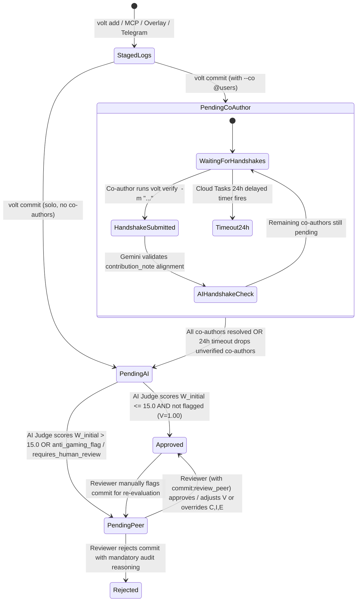

# 05 — Commit Lifecycle, Co-Author Handshake & AI Judge Pipeline

**Document ID:** `VOLT-DOC-05`  
**Parent Index:** [00-index.md](file:///Users/ashwinsharma/coldcrunch/volt/docs/00-index.md)

---

## 1. End-to-End Commit State Machine

Per **ADR-004**, `volt` enforces a **Sequential Pipeline**: when a commit tags co-authors (`--co @user2`), all co-author handshakes (or the 24-hour expiration timer) must resolve **before** the commit is dispatched to the Gemini 1.5 Flash AI Judge. This ensures the AI Judge evaluates the primary author's summary alongside every verified co-author's `contribution_note` in a single, holistic pass.



---

## 2. Detailed Pipeline Walkthrough

### Step 1: Staging Micro-Logs (`volt add`)
1. User logs micro-tasks throughout the day via CLI (`volt add`), MCP (`volt_stage_log`), Mac Overlay (`Cmd+Shift+L`), Web UI, or Telegram Bot.
2. Logs are written to `staged_logs` (with `commit_id = NULL`) and mirrored in Upstash Redis (`volt:staged:<user_id>`) for instant status queries.

### Step 2: Commit Creation (`volt commit`)
1. User executes `volt commit` with:
   * `type`: `'output'` or `'insight'`
   * `domain`: `'engineering' | 'research' | 'ops' | 'finance' | 'pitch'` (defaults to `user.default_domain`)
   * `summary`: Concise synthesis of the deliverable or disproved hypothesis
   * `artifact`: Either `--pr <github_pr_or_commit_url>` (verified via Installed GitHub App) OR `--file <path>` (uploaded to `volt-artifacts` bucket)
   * `co_authors`: Optional list of `@handles`
2. The API generates an 8-character Git-style `short_hash` (first 8 hex characters of SHA-256 over `author_id + summary + timestamp + random_salt`).
3. All uncommitted `staged_logs` for `author_id` are snapshotted into `commits.staged_snapshot` (`JSONB`) and marked with `commit_id` and `committed_at`.
4. **Artifact Verification Pre-Pass:**
   * If `artifact_type == 'github_app'`, the backend queries the GitHub REST API using the organization/user's GitHub App Installation token and stores PR/commit stats in `commits.artifact_metadata`.
   * If `artifact_type == 'file_upload'`, the backend verifies the uploaded object in `artifacts` (extracting `.ipynb` cell/output counts, PDF metadata, or image checksums) and stores it in `commits.artifact_metadata`.
5. **Branching on Co-Authors:**
   * **Case A — Solo Commit (0 Co-Authors):**
     * `commits.status` is set to `'pending_ai'`.
     * `commits.verified_participant_count` is set to `1`.
     * Fastify immediately enqueues a Google Cloud Task to `POST /v1/internal/tasks/evaluate-commit`.
   * **Case B — Collaborative Commit ($\ge 1$ Co-Authors):**
     * `commits.status` is set to `'pending_coauthor'`.
     * `commits.coauthor_deadline_at` is set to `NOW() + INTERVAL '24 hours'`.
     * Rows are inserted into `commit_coauthors` with `status = 'pending'`.
     * Notifications are dispatched to each tagged co-author via Telegram Bot (with inline verify prompt) and Web UI real-time feed.
     * Fastify enqueues a **delayed Google Cloud Task** scheduled for `scheduleTime = NOW() + 24 hours` targeting `POST /v1/internal/tasks/resolve-coauthor-timeout`.

---

## 3. Co-Author Verification & 24-Hour Timeout Resolution

### 3.1 Co-Author Handshake (`POST /v1/commits/:shortHash/verify`)
When a tagged co-author submits their 1-line `contribution_note` (or chooses to reject the tag):
1. **Explicit Rejection (`action: "reject"`):**
   * `commit_coauthors.status` is set to `'rejected'`.
   * The user is excluded from the participant count $N$.
2. **Verification (`action: "verify"`, `contribution_note: "..."`):**
   * Gemini 1.5 Flash runs a lightweight **Handshake Alignment Check** verifying that `contribution_note` is a genuine description of work related to `commit.summary` and `commit.staged_snapshot` (preventing "lgtm" or gibberish tag-farming).
   * If valid: `commit_coauthors.status = 'verified'`, `ai_validated = true`, `verified_at = NOW()`.
   * If invalid: returns `422 Unprocessable Entity` with the AI reason so the co-author can provide a real contribution note.
3. **Completion Check:**
   * After updating the co-author row, the backend checks if any `commit_coauthors` rows for `commit_id` still have `status = 'pending'`.
   * If **zero** rows remain `'pending'`, the commit immediately transitions to `status = 'pending_ai'`, updates `verified_participant_count` to $N = 1 + \text{count(verified)}$, and dispatches `POST /v1/internal/tasks/evaluate-commit`.

### 3.2 24-Hour Timeout Task (`POST /v1/internal/tasks/resolve-coauthor-timeout`)
When the 24-hour Cloud Task fires:
1. If `commit.status != 'pending_coauthor'`, the task is a no-op (already resolved early) and returns `200 OK`.
2. Any remaining `commit_coauthors` rows with `status = 'pending'` are updated to `status = 'timed_out'`.
3. `commits.verified_participant_count` is computed as $N = 1 + \text{count(verified)}$ (dropping all `'rejected'` and `'timed_out'` users).
4. `commits.status` transitions to `'pending_ai'`, and the commit is dispatched to `POST /v1/internal/tasks/evaluate-commit`.

---

## 4. AI Judge Evaluation Specification (`POST /v1/internal/tasks/evaluate-commit`)

### 4.1 Input Context Provided to Gemini 1.5 Flash
The evaluation worker constructs a structured prompt containing:
* `commit.type` (`output` vs. `insight`) and `commit.domain`
* `commit.summary`
* `commit.staged_snapshot` (chronological micro-logs with timestamps)
* Verified co-authors and their `contribution_note` entries
* Verified `artifact_type` and `artifact_metadata` (e.g., GitHub PR files changed, additions, deletions, merged state, CI check status; or uploaded `.ipynb` / PDF metadata)
* Author's recent 5 commits (to detect duplicate submission or micro-splitting gaming)

### 4.2 Structured JSON Schema (`temperature: 0.1`)
```json
{
  "name": "evaluate_volt_commit",
  "strict": true,
  "schema": {
    "type": "object",
    "properties": {
      "c_complexity": { "type": "integer", "enum": [1, 2, 3, 5, 8, 13] },
      "i_impact": { "type": "number", "enum": [0.5, 1.0, 1.5, 2.0, 3.0] },
      "e_evidence": { "type": "number", "enum": [0.5, 1.0, 1.2] },
      "reasoning": { "type": "string" },
      "requires_human_review": { "type": "boolean" },
      "anti_gaming_flag": { "type": "boolean" }
    },
    "required": [
      "c_complexity",
      "i_impact",
      "e_evidence",
      "reasoning",
      "requires_human_review",
      "anti_gaming_flag"
    ],
    "additionalProperties": false
  }
}
```

### 4.3 Hard Enforcement Rules Post-AI Output
Even after receiving Gemini's JSON response, `@volt/math` applies deterministic guardrails before inserting into `score_audits`:
1. **Evidence Ceiling Enforcement:**
   * If `commit.artifact_type == 'none'`, `e_evidence` is forcibly clamped to `0.50` regardless of LLM output.
   * If `commit.artifact_type == 'github_app'` and `artifact_metadata.merged == true` and `artifact_metadata.ci_passed == true`, `e_evidence` is `1.20`.
2. **Timeliness Decay ($D$):** Calculated deterministically from `commit.work_date` vs. `commit.created_at` in `Asia/Kolkata`.
3. **Auto-Approval vs. Peer Review Routing:**
   * Compute $W_{\text{initial}} = C^{1.4} \times I \times E$ and $W_c = \text{round}(W_{\text{initial}} \times 1.00 \times D, 2)$.
   * Insert immutable row into `score_audits` (`is_ai_grade = true`, `v_consensus = 1.00`).
   * If $W_{\text{initial}} \le 15.00$ AND `!requires_human_review` AND `!anti_gaming_flag`:
     * Transition `commit.status = 'approved'`, `finalized_at = NOW()`.
     * Compute individual participant awards ($W_{u, c}$) using $N = \text{verified\_participant\_count}$ and write to `commits.author_awarded_points` and `commit_coauthors.awarded_points`.
   * Otherwise ($W_{\text{initial}} > 15.00$ or flagged):
     * Transition `commit.status = 'pending_peer'` and notify users holding the `commit:review_peer` scope.

---

## 5. Evening Sweeper & Multimodal Voice Pipeline (7:30 PM IST)

### 5.1 Daily 19:30 IST Cron (`POST /v1/internal/tasks/evening-sweep`)
Triggered daily by Google Cloud Scheduler at `30 19 * * *` (`Asia/Kolkata`):
1. Queries active users with a linked `telegram_chat_id` where:
   * Uncommitted `staged_logs` count $> 0$, OR
   * Total commits created for today's `work_date` $== 0$.
2. Sends an interactive Telegram message listing their uncommitted micro-logs with inline keyboard actions:
   * `[Bundle & Commit Output]`
   * `[Bundle & Commit Insight]`
   * `[View Today's Status]`

### 5.2 Telegram Hold-to-Talk Voice Note Pipeline
When a user sends a voice note (`.ogg` Opus audio) to the Telegram Bot:
1. Fastify webhook downloads the `.ogg` buffer from Telegram's File API and passes it to a Cloud Task (`POST /v1/internal/tasks/process-telegram-voice`).
2. The worker invokes **Gemini 1.5 Flash** with multimodal audio input + structured output schema to extract:
   * `intent`: `'stage_only' | 'commit_output' | 'commit_insight'`
   * `transcript`: Clean text transcription
   * `extracted_micro_logs`: Array of distinct tasks mentioned
   * `commit_summary`: Synthesized deliverable summary
   * `co_author_handles`: Any `@teammates` mentioned
3. The worker stages the extracted micro-logs, creates the commit (if intent is commit), runs the evaluation pipeline, and replies in Telegram with the formatted score card (`[a9f3c12b] C:5 | I:1.5x | E:0.5x = 7.14 pts`).
