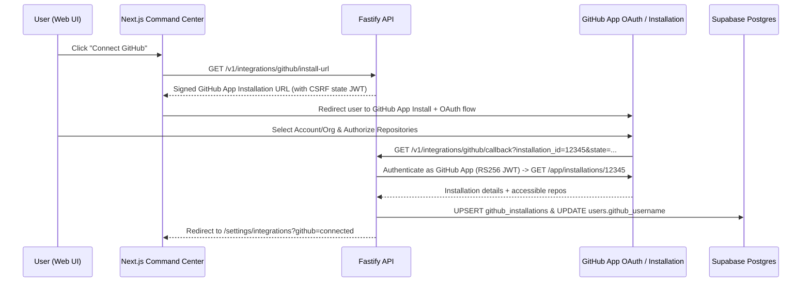

# 06 — GitHub App Integration & Artifact Verification Pipeline

**Document ID:** `VOLT-DOC-06`  
**Parent Index:** [00-index.md](file:///Users/ashwinsharma/coldcrunch/volt/docs/00-index.md)

---

## 1. Strict Two-Path Artifact Verification Model

Per **ADR-005**, `volt` does **not** perform brittle, unauthenticated HTML scraping of arbitrary third-party URLs. To qualify for an Evidence Multiplier of $E = 1.0\text{x}$ or $E = 1.2\text{x}$, a commit must provide proof through one of two first-party verified mechanisms:

| Verification Path | Target Domains | How Proof is Provided | How `volt` Verifies It |
| :--- | :--- | :--- | :--- |
| **Path 1: Installed GitHub App** | Engineering & Code Repositories | User links a GitHub PR URL or commit URL (or runs `volt commit` / `volt_commit_work` inside a Git repo). | Uses the installed `volt` GitHub App installation token via GitHub REST API to inspect PR merge status, CI check runs, changed files, and commit authorship. |
| **Path 2: Direct Artifact Upload** | AI Research (`.ipynb`), Ops, Finance, Pitching | User uploads the file directly (`.ipynb` Colab notebook, PDF deck, `.xlsx`/`.csv` financial model, screenshot proof) via Web UI, CLI `--file`, Mac Overlay, or Telegram Bot. | File is stored in the `volt-artifacts` bucket (Supabase Storage / GCS) with SHA-256 checksum and inspected by the backend parser + multimodal Gemini 1.5 Flash Judge. |

If neither a GitHub App-verified PR/commit nor an uploaded artifact file is attached, the commit is classified as `artifact_type = 'none'` and strictly capped at **$E = 0.5\text{x}$ (Unverified Text Claim)**.

---

## 2. Seamless "Connect GitHub" User Experience

### 2.1 User Flow in the Web Command Center
1. In the Web Command Center header and **Settings $\rightarrow$ Integrations** page, users see a prominent **"Connect GitHub"** button (displaying their connection status and linked repositories).
2. Clicking **"Connect GitHub"** redirects the user to:
   `https://github.com/apps/<VOLT_GITHUB_APP_SLUG>/installations/new?state=<signed_csrf_jwt>`
3. The user selects their personal GitHub account or Organization (e.g., `coldcrunch`) and grants repository read access.
4. GitHub redirects back to `GET /v1/integrations/github/callback?installation_id=...&setup_action=install&state=...`.
5. The Fastify backend:
   * Validates the signed `state` token to identify the authenticated `volt` user.
   * Exchanges the `installation_id` with the GitHub App Private Key (RS256 JWT) to fetch installation metadata and accessible repositories.
   * Upserts the record in `github_installations` and links the user's `github_user_id` and `github_username` on `users`.
   * Redirects back to `AppRoutes.settingsGitHub` with a connected status badge.



### 2.2 Required GitHub App Permissions (Least Privilege)
When configuring the `volt` GitHub App, only read-only metadata permissions are required:
* **Repository Permissions:**
  * `Pull requests`: **Read-only** (inspect PR title, body, state, merged status, additions, deletions, changed files)
  * `Contents`: **Read-only** (inspect commit metadata and diff stats when a commit SHA URL is provided)
  * `Checks`: **Read-only** (verify CI/CD check suites passing for the $E = 1.2\text{x}$ multiplier)
  * `Metadata`: **Read-only** (mandatory default)
* **Webhook Events Subscribed:**
  * `installation` and `installation_repositories` (to keep `github_installations.repositories_snapshot` automatically synced when repos are added/removed).
  * `pull_request` (optional automatic update if a PR attached to a pending commit is merged).

---

## 3. GitHub PR & Commit Verification Logic

When a user provides `--link https://github.com/<owner>/<repo>/pull/<number>` (or `/commit/<sha>`), or when `volt` CLI / `volt-mcp` auto-detects the current Git branch's open PR:

1. **URL Parsing:** Extract `owner`, `repo`, and `pull_number` (or `commit_sha`).
2. **Installation Lookup:** Look up the active `github_installations` row matching `account_login = owner` (or where `repositories_snapshot` contains `owner/repo`).
   * If the repository is not covered by an installed GitHub App, the API returns a clear `400 Bad Request` (`GITHUB_APP_NOT_INSTALLED_FOR_REPO`) prompting the user to click **"Connect GitHub"** or upload an artifact file.
3. **GitHub API Fetch:** Mint a short-lived installation token (`POST /app/installations/:id/access_tokens`, cached in Upstash Redis for 50 minutes) and fetch:
   * `GET /repos/:owner/:repo/pulls/:pull_number`
   * `GET /repos/:owner/:repo/commits/:head_sha/check-runs`
4. **Structured `artifact_metadata` Stored on Commit:**
   ```json
   {
     "provider": "github_app",
     "owner": "coldcrunch",
     "repo": "volt",
     "pr_number": 42,
     "title": "feat(math): implement deterministic weightage engine",
     "state": "closed",
     "merged": true,
     "ci_passed": true,
     "additions": 642,
     "deletions": 84,
     "changed_files": 9,
     "author_login": "ashwin",
     "head_sha": "a9f3c12b4e8d..."
   }
   ```
5. **Deterministic Evidence Mapping:**
   * If `merged == true` AND `ci_passed == true`: Eligible for **$E = 1.2\text{x}$**.
   * If open PR or unmerged commit with verified diff: **$E = 1.0\text{x}$**.

---

## 4. Direct File Upload Pipeline (`artifact_type = 'file_upload'`)

For AI Research, Operations, Finance, and Pitching tasks (or engineering tasks outside GitHub):

### 4.1 Presigned Upload Flow
1. Client requests a signed upload URL via `POST /v1/artifacts/upload-url` with `{ filename, mimeType, sizeBytes, sha256Checksum }`.
2. Backend validates allowed MIME types and size limits ($\le 25\text{ MB}$):
   * **Notebooks & Data:** `.ipynb` (`application/x-ipynb+json`), `.csv`, `.json`, `.parquet`
   * **Documents & Models:** `.pdf`, `.md`, `.xlsx`, `.pptx`
   * **Visual Proof / Screenshots:** `.png`, `.jpg`, `.webp`
3. Backend creates a pending row in `artifacts` and returns a presigned upload URL for the `volt-artifacts` bucket.
4. Client uploads the file bytes directly to storage and passes `artifactId` when calling `POST /v1/stage` or `POST /v1/commits`.

### 4.2 Artifact Inspection & Metadata Extraction
Before invoking the AI Judge, the worker inspects the uploaded artifact:
* **Jupyter / Colab Notebooks (`.ipynb`):** Parses the JSON structure to count code cells, markdown cells, execution counts, and extracts final output cells/tables/metrics so Gemini 1.5 Flash can verify empirical research claims ($E = 1.0\text{x}$ or $1.2\text{x}$ if reproducible benchmarks are present).
* **Images / Screenshots / PDFs:** Passed directly to **Gemini 1.5 Flash multimodal vision** alongside the commit summary to verify that the uploaded screenshot/document genuinely substantiates the claim.
