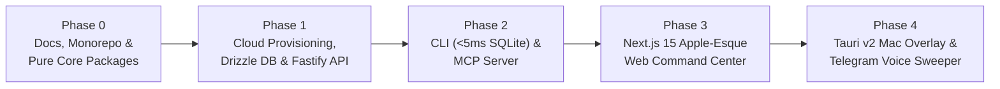

# 10 — Phased Engineering Roadmap & Verification Matrix

**Document ID:** `VOLT-DOC-10`  
**Parent Index:** [00-index.md](file:///Users/ashwinsharma/coldcrunch/volt/docs/00-index.md)

---

## 1. Execution Strategy & Collaborative Pair-Programming Workflow

We build `volt` as a production-grade system in **five verified phases**. Each phase has strict completion criteria, automated unit/integration tests, TypeScript `strict: true` validation, and a clear division of labor between us.

---

## 2. Granular Phase Breakdown

### Phase 0: Foundation, Central Types, Math Engine & PBAC Core
* **Deliverables:**
  1. Complete `docs/00-index.md` .. `docs/10-engineering-roadmap.md` documentation suite and updated master specification.
  2. Initialize Git repository (`feat/phase-0-foundation` branch) and Bun + Turborepo workspace (`package.json`, `turbo.json`, `tsconfig.base.json`).
  3. Build `@volt/types` (`packages/types`): All domain types, math interfaces, PBAC types, GitHub App types, API DTOs, and centralized `ApiRoutes` / `AppRoutes` constants.
  4. Build `@volt/math` (`packages/math`): Deterministic $W_c$ calculator, IST timeliness decay $D$, 1–3 author $100\%$ duplication vs. $4+$ group split ($3/N$) with rejected/timeout exclusion, and Dynamic Pool Share % calculator + comprehensive unit test suite (`bun test`).
  5. Build `@volt/policy` (`packages/policy`): Flat Permission Scopes evaluator, reusable Policy Group resolver, and Conflict-of-Interest peer review guards + unit test suite.
  6. Build `@volt/config` (`packages/config`): Strict Zod environment and API payload schemas.

### Phase 1: Cloud-Native Database, Provisioning & Serverless Fastify API
* **Deliverables:**
  1. Build `@volt/db` (`packages/db`): Modular Drizzle ORM schema, SQL migration generator, append-only `score_audits` immutability trigger, and typed repositories.
  2. Build `bun run infra:setup` provisioning utility and connect live Supabase PostgreSQL 16, Supabase Storage (`volt-artifacts`), Upstash Redis, and Gemini 1.5 Flash credentials.
  3. Build `@volt/api` (`apps/api`):
     * Hybrid Auth plugin (Supabase JWT + `volt_sk_...` SHA-256 API keys) and PBAC middleware.
     * Staging endpoints (`/v1/stage`, `/v1/stage/batch`) backed by Upstash Redis + Postgres.
     * Commit endpoints (`/v1/commits`, `/v1/commits/:shortHash/verify`, `/v1/commits/:shortHash/review`).
     * GitHub App installation flow (`/v1/integrations/github/*`) and PR/commit metadata verifier.
     * Direct artifact presigned upload flow (`/v1/artifacts/*`) and `.ipynb`/PDF/image metadata extractor.
     * Sequential Co-Author Handshake $\rightarrow$ 24h Timeout Task $\rightarrow$ Gemini 1.5 Flash AI Judge worker endpoints (`/v1/internal/tasks/*`).
     * Billing Cycle & Dynamic Pool Share endpoints (`/v1/cycles/*`).

### Phase 2: `<50ms` Local-Queue CLI (`volt`) & MCP Server (`volt-mcp`)
* **Deliverables:**
  1. Build `@volt/cli` (`apps/cli`):
     * Local `bun:sqlite` write-ahead queue (`~/.volt/queue.sqlite`) achieving `<5ms` execution for `volt add`.
     * Detached background sync daemon flushing to `/v1/stage/batch`.
     * Commands: `volt login`, `volt add`, `volt status`, `volt commit` (with Git branch PR auto-detection and `--file` upload), and `volt verify`.
     * Standalone binary compilation (`bun build --compile`).
  2. Build `@volt/mcp` (`apps/mcp`):
     * MCP stdio server exposing `volt_stage_log`, `volt_commit_work`, `volt_get_status`, and `volt_verify_coauthor` for Antigravity and Claude Desktop.

### Phase 3: Apple-Esque Web Command Center (`apps/web`)
* **Deliverables:**
  1. Next.js 15 App Router application styled with macOS Sequoia / Linear dark glassmorphism (`#09090B`, `1px` specular borders, `JetBrains Mono` equations, `lucide-react` icons, zero emojis).
  2. Top Spotlight Quick-Capture & Commit bar with GitHub PR selector and drag-and-drop proof upload.
  3. Live Impact Stream with expandable math pills and immutable audit history drawer.
  4. Peer Review & Co-Author Handshake Inbox with interactive $V \in [0.70, 1.30]$ slider and $C, I, E$ overrides.
  5. Dynamic Pool Share & Analytics Matrix with cycle switcher, domain breakdown, and CSV payroll export.
  6. **"Connect GitHub"** one-click installation UI, API Key manager, and PBAC Policy Group admin console.
  7. Global `Cmd + K` Command Palette.

### Phase 4: Ambient Tauri v2 Mac Overlay & Telegram Voice Sweeper
* **Deliverables:**
  1. Build `@volt/mac-overlay` (`apps/mac-overlay`): Tauri v2 floating Spotlight bar summoned via `Cmd + Shift + L` writing directly to `~/.volt/queue.sqlite` and syncing with the API.
  2. Complete Telegram Bot webhook (`/v1/webhooks/telegram`), Gemini 1.5 Flash multimodal `.ogg` voice-note-to-commit pipeline, and the 7:30 PM IST Google Cloud Scheduler Evening Sweeper.

---

## 3. Quality Gate Checklist (Applied to Every PR / Milestone)

- [ ] **File Length Check:** Zero source files exceed 200 lines.
- [ ] **Centralized Types Check:** Zero `interface` or `type` declarations exist outside `packages/types/src/`.
- [ ] **Type Safety Check:** `bun run typecheck` passes with `strict: true` and zero occurrences of `any` or unvalidated `unknown`.
- [ ] **Route Constants Check:** Zero hardcoded URL paths in components, hooks, services, or tests; all reference `ApiRoutes` or `AppRoutes`.
- [ ] **Zero Emoji Check:** Zero Unicode emojis in source code, UI strings, or CLI output.
- [ ] **Automated Test Suite:** `bun test` passes across all unit and integration suites.
